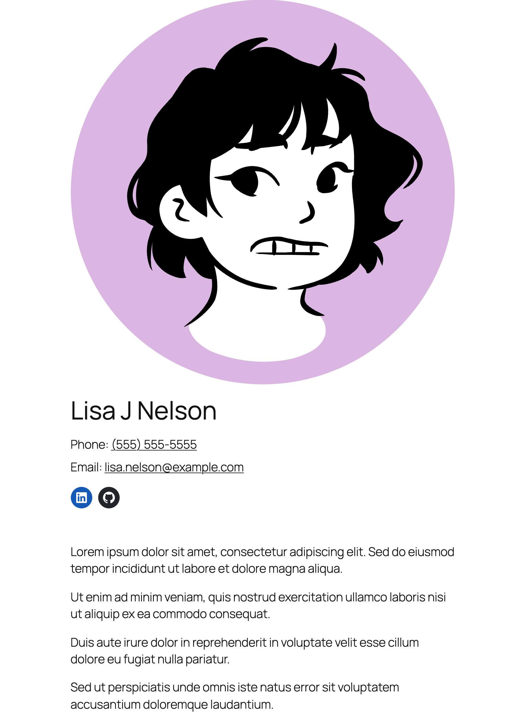
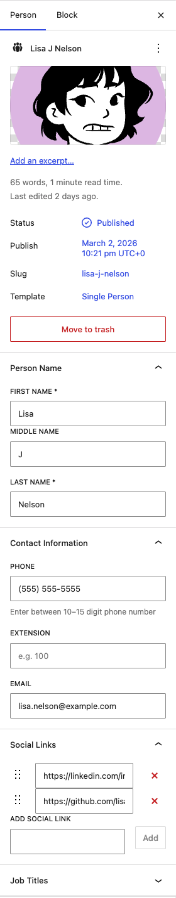
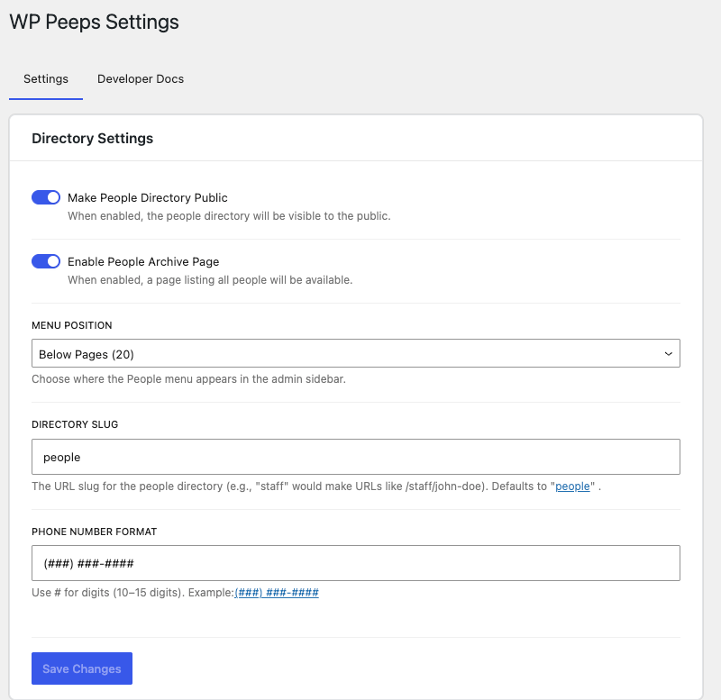

# Peeps – People Directory

[](https://playground.wordpress.net/?blueprint-url=https://raw.githubusercontent.com/philhoyt/WP-Peeps/main/_playground/blueprint.json)

Adds a People post type with name, phone, email and social link fields, plus blocks that display them.



Each person is a `ph_peeps_people` post with first, middle and last name, phone number and extension, email address, a list of social links and a featured image. The fields live in an editor sidebar panel; the post title is generated from the name fields and cannot be edited directly.

Four blocks read those fields: Full Name, Phone Number, Email Address and Social Links. The plugin registers a single person template and a people archive template that use them, and both can be edited in the Site Editor. The blocks also work inside Query Loop blocks.

## Requirements

- WordPress 6.7.2 or later (6.7.0 and 6.7.1 cannot register the plugin's block templates)
- PHP 8.0 or later
- Node.js 22 or later to build the JavaScript

## Installation

1. Download `peeps-people-directory.zip` from the [latest release](https://github.com/philhoyt/WP-Peeps/releases/latest).
2. In the WordPress admin, go to Plugins > Add New Plugin > Upload Plugin and choose the zip.
3. Activate the plugin.

Updates come from GitHub releases through Plugin Update Checker, which only installs the zip attached to a release. The plugin is not on WordPress.org.

## Usage

Add a person at People > Add New. Fill in the name fields in the Person Name panel, the phone and email in Contact Information, and links in Social Links. A phone number must have 10 to 15 digits; the editor rejects anything else and stores only the digits.



The single person and archive templates are registered on activation. Open Appearance > Editor > Templates to change them. To build your own layout, add the Peeps blocks to a template or a Query Loop:

| Block | What it renders | Options |
|-------|-----------------|---------|
| `ph-peeps/full-name` | The person's name | Which parts to show, heading tag, link to the profile, open in new tab, `rel` |
| `ph-peeps/phone` | The formatted phone number | Prefix text, wrapper tag, `tel:` link |
| `ph-peeps/email` | The email address | Prefix text, wrapper tag, `mailto:` link |
| `ph-peeps/social-links` | One icon per social link | Default or Logos Only style, show labels, icon size, icon and background colour, open in new tab, flex layout |

The Social Links block chooses an icon by matching each URL against 47 patterns: the networks the core Social Icons block covers plus Discord, TikTok, Threads, Patreon, VK, 500px, Gravatar, RSS and Atom feeds, and `mailto:` links.

## Configuration

People > Settings:

| Setting | Option key | Default | Effect |
|---------|-----------|---------|--------|
| Directory Slug | `ph_peeps_cpt_slug` | `people` | URL base for person pages and the archive. Save Settings > Permalinks after changing it. |
| Phone Number Format | `ph_peeps_phone_format` | `(###) ###-####` | One `#` per digit; 10 to 15 of them. |
| Enable Archive | `ph_peeps_has_archive` | on | Whether `/people/` lists everyone. |
| Enable Individual Profile Pages | `ph_peeps_public_cpt` | on | Off: person URLs return 404, people are left out of the sitemap and site search, and Full Name renders without a link. People stay queryable in Query Loop and the REST API. |
| Menu Position | `ph_peeps_menu_position` | 25 | Where People sits in the admin sidebar. |

The Developer Docs tab on the same page lists the post type key, REST base, meta keys, block names and option keys.



### Meta keys

All are registered with `show_in_rest` and readable at `/wp-json/wp/v2/ph_peeps_people`.

`ph_peeps_first_name`, `ph_peeps_middle_name`, `ph_peeps_last_name`, `ph_peeps_phone` (digits only), `ph_peeps_phone_ext`, `ph_peeps_email`, `ph_peeps_social_links` (array of `{ platform, url }`).

## Development

```bash
npm install
composer install
npm start             # watch src/ and rebuild into build/
npm run build         # production build
npm run lint:js
npm run lint:css
npm run format
composer run lint     # phpcs
composer run lint-fix
npm test              # Jest unit tests for src/editor/utils.js
npm run pot           # regenerate languages/peeps-people-directory.pot (needs WP-CLI)
npm run plugin-zip    # build the distributable zip
```

PHP tests and the front-end smoke test run inside wp-env:

```bash
npm run env:start
npm run test:php      # PHPUnit against tests/ (block render functions, meta sanitizers)
npm run test:smoke    # publishes one person and requests the home, archive and single pages with WP_DEBUG on
```

`composer install` copies Plugin Update Checker from `vendor/` into `lib/`, which ships in the zip.

To fill a dev site with sample people (needs WP-CLI; featured images are SVGs, so the Safe SVG plugin must be active):

```bash
wp eval-file wp-content/plugins/peeps-people-directory/bin/generate-test-data.php 20
```

CI (`.github/workflows/ci.yml`) runs phpcs, ESLint, Stylelint and Jest on every push and pull request, then runs the smoke test and PHPUnit on WordPress 6.7.2 with PHP 8.0 and on the latest WordPress with PHP 8.4.

## Releases

Bump the version in `peeps-people-directory.php`, `package.json`, the four `block.json` files and `Stable tag` in `readme.txt`, add the changelog entry to `readme.txt`, then push a lowercase `v` tag:

```bash
git tag v2.6.0 && git push origin v2.6.0
```

The tag must be lowercase: Plugin Update Checker strips the prefix with a case-sensitive `ltrim`, so `V2.6.0` would never be offered as an update. The release workflow builds the assets, runs `npm run plugin-zip`, takes that version's section of the `readme.txt` changelog as the release notes, and attaches `peeps-people-directory.zip` and `readme.txt` to the GitHub release.

## Limitations

- One phone number and one email address per person.
- Turning off profile pages is not access control. Person data is still available through the REST API and Query Loop.
- Deleting the plugin removes its five options but keeps people posts and their meta.
- Changing the Directory Slug needs a visit to Settings > Permalinks before the new URLs work.

## Changelog

### 2.6.0

- Added translation loading for the editor sidebar and the settings page, with a `languages/peeps-people-directory.pot` template.
- Made the "Phone:" and "Email:" labels in the default single person template translatable.
- Deleting the plugin now removes its five settings. People and their details are kept.
- Tested with WordPress 7.1.

### 2.5.1

- Fixed the Social Links block keeping both the Default and Logos Only style classes when Logos Only was selected, and merging a custom class with the style class into one name.
- Fixed the Social Links block reading the wrong person inside Query Loop patterns that set a post explicitly. It now reads the post from block context like the other blocks.
- Fixed the Full Name, Phone and Email blocks accepting HTML tags their toolbar does not offer.
- Block rendering is now loaded once at startup instead of through overlapping registration paths.

### 2.5.0

- Renamed the "Make People Directory Public" setting to "Enable Individual Profile Pages". It was never access control; the setting only decides whether each person has a page of their own. The stored option key is unchanged.
- When profile pages are off, people are now left out of the core sitemap and site search, the Full Name block renders without a link, and the "View" row action is hidden on the People list.
- Raised the minimum WordPress version to 6.7.2. Versions 6.7.0 and 6.7.1 could not register the plugin's single and archive templates.

### 2.4.0

- Updates are now delivered from GitHub releases instead of the WordPress.org directory.

### 2.3.2

- Fixed a fatal error on person pages and the people archive in 2.3.0 and 2.3.1. The Social Links block called a function that does not exist in WordPress.
- Fixed phone numbers with fewer than 10 or more than 15 digits being stored as an error object. Invalid numbers are now rejected in the editor and never stored.
- Fixed the Phone and Email blocks breaking the page when a stored value is not text.

### 2.3.1

- Fixed the plugin zip missing from the 2.3.0 GitHub release.
- Removed uncompiled source files from the plugin zip.

### 2.3.0

- Fixed output escaping on the plugin settings action link.
- Fixed `linkRel` attribute sanitization in the Full Name block.
- Fixed editor context detection in the Social Links block to use `wp_is_block_editor()`.
- Fixed prefix field HTML being stripped on the front end; bold and italic now render.
- Fixed missing text domain on translatable strings in the blocks.
- Fixed a duplicate SCSS selector in the admin styles.
- Upgraded `@wordpress/scripts` to v32 and moved to the ESLint flat config.
- Replaced the deprecated `render()` with `createRoot()` on the settings page.
- Added a GitHub Actions workflow for WordPress.org SVN deployment.
- Removed dead job title taxonomy code.

### 2.2.2

- Added a Developer Docs tab to the settings page with the post type key, meta keys, block names and option keys.
- Fixed the Phone block showing nothing in the editor when no number is set; it now shows the configured format as a placeholder.

### 2.2.0

- Added icon detection for Discord, TikTok, Threads, Patreon, VK, 500px, RSS and Atom feeds, Gravatar and `mailto:` links.
- The Full Name block keeps at least one name part enabled and warns in the editor when none is selected.
- Fixed email validation to trim whitespace before checking the address.
- Removed a text alignment class that the Phone and Email blocks applied by hand; block supports handle it.
- Fixed the Email block placeholder check comparing against a hardcoded string.
- Moved the default phone format, slug and menu position into one place.
- Merged several `useSelect` calls in the editor panel into one.
- Removed duplicate constants and helpers across block files.

### 2.1.0

- The People post type is now always available in the Query Loop block, regardless of the public setting.
- Single person pages return 404 when the directory is set to private.
- The Social Links block preview now updates when links are added, removed or reordered, without saving the post.
- Fixed editor sidebar styles not applying on the settings page.
- Fixed spacing between fields in the Person Name, Contact Information and Social Links panels.
- Fixed `TextControl` deprecation warnings for WordPress 7.
- Added a phone extension field to the Contact Information panel.

### 2.0.0

- BREAKING: Changed all prefixes from `wp_peeps` to `ph_peeps` for WordPress directory compliance.
- BREAKING: Post type changed from `wp_peeps_people` to `ph_peeps_people`.
- BREAKING: Meta keys changed from `wp_peeps_*` to `ph_peeps_*`.
- BREAKING: Option names changed from `wp_peeps_*` to `ph_peeps_*`.
- BREAKING: Block names changed from `wp-peeps/*` to `ph-peeps/*`.
- Renamed the plugin to "Peeps – People Directory".
- Changed the PHP namespace from `WP_Peeps` to `PH_Peeps`.
- Changed the text domain from `wp-peeps` to `peeps-people-directory`.
- Added sanitization callbacks for boolean settings.
- Existing posts and settings need to be migrated or re-entered.

### 1.3.1

- Renamed the plugin from "WP Peeps" to "Peeps" for WordPress directory compliance.

### 1.3.0

- Added a block template for the people archive with featured image, name, contact information and social links.

### 1.2.0

- Flush rewrite rules on activation and deactivation.
- Added a notice when a setting that affects permalinks changes (slug, public status, archive).

### 1.1.0

- Added a block template for single person posts with featured image, full name, contact information and social links. The template can be edited in the Site Editor.

### 1.0.0

- Stable release.
- Fixed XSS issues in the social links and prefix fields.
- Added validation and sanitization for all inputs.
- Improved error handling and logging.
- Added PHPDoc throughout.
- Reduced database queries.
- Fixed an infinite loop in the title update function.
- Added namespace declarations to all render callbacks.
- Standardized path handling.

### 0.1.1

- Disabled post title editing; the title comes from the name fields.

### 0.1.0-beta.3

- Fixed social links styling.
- Phone numbers now accept 10 to 15 digits.
- Added a toggle to disable the archive.
- Added a menu position setting.

### 0.1.0-beta.2

- Removed the Job Title field.
- Added inline editing of the prefix text on the Phone and Email blocks.
- Full Name, Email and Phone now show data in the Query Loop editor preview.

### 0.1.0-beta.1

- Added the Full Name, Phone Number, Email Address and Social Links blocks.
- Added custom phone number formatting.

### 0.1.0

- Initial release with the People post type, settings page, phone number formatting, required name fields and contact fields.

## License

GPL-2.0-or-later
